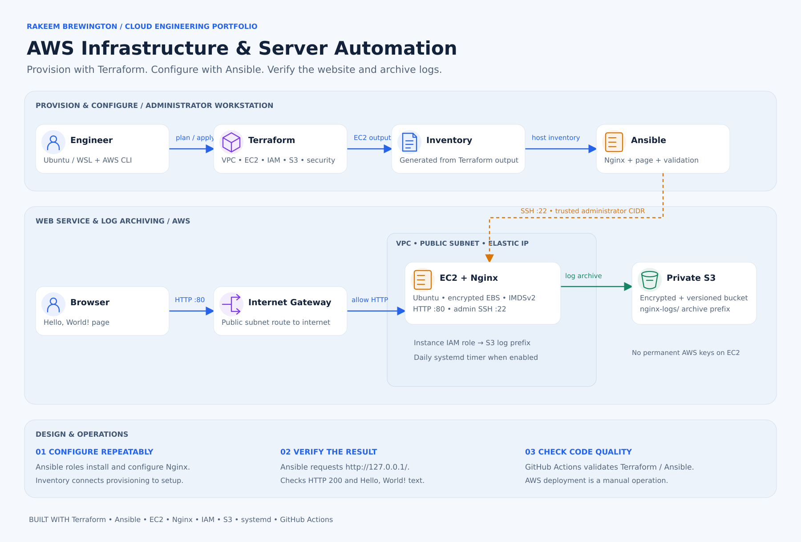

# AWS Infrastructure Automation — Terraform and Ansible

Infrastructure as Code and configuration-management project that provisions an
AWS EC2 web server with Terraform and configures it with Ansible.

The assignment requirements are implemented first and remain easy to identify.
Security, log archiving, automated verification, and code-quality checks are
additional improvements.

For the full phase-by-phase explanation and the business decision behind every
step, see [PROJECT_WALKTHROUGH.md](PROJECT_WALKTHROUGH.md).

## Project at a glance

**Business scenario:** Manually creating cloud servers and configuring web software is slow, inconsistent, and difficult to audit.

**What I built:** Used Terraform to provision EC2, networking, IAM, security groups, and S3. Used Ansible to configure Nginx, deploy a test page, validate HTTP responses, and optionally archive web-server logs to S3.

**Verified outcomes**
- Confirmed Ansible could connect to the provisioned instance over SSH.
- Validated the deployed page with an **HTTP 200** response and expected content.
- Added infrastructure and configuration checks, then removed lab resources to limit unnecessary AWS spend.

**Key decisions:** Terraform defines cloud resources consistently; Ansible applies repeatable, idempotent server configuration; least-privilege IAM and restricted SSH access reduce operational risk.

**Production improvements to prioritize:** HTTPS, private administration through SSM, remote Terraform state and locking, monitoring alerts, and automated recovery tests.

**Stack:** AWS EC2 · S3 · IAM · VPC · Terraform · Ansible · Linux · Nginx · GitHub Actions

**Explore:** [Architecture](#architecture) · [Detailed walkthrough](PROJECT_WALKTHROUGH.md) · [Source code](https://github.com/Rakeem08/terraform-ansible-aws-automation)

> **Portfolio environment:** The website IP below documents a temporary lab deployment, not a maintained production service.

## Hosted website

- Live website: [http://100.57.227.180](http://100.57.227.180)
- GitHub repository: [terraform-ansible-aws-automation](https://github.com/Rakeem08/terraform-ansible-aws-automation)
- Required page content: **Hello, World!**


## Assignment coverage

| Assignment requirement | Implementation | Evidence |
| --- | --- | --- |
| Provision an EC2 instance | Terraform | **terraform/compute.tf** |
| Provision an S3 bucket | Terraform | **terraform/storage.tf** |
| Create IAM roles | Terraform | **terraform/iam.tf** |
| Create security groups | Terraform | **terraform/security.tf** |
| Install a web server | Ansible | **ansible/roles/nginx/tasks/main.yml** |
| Deploy Hello, World! | Ansible template | **ansible/roles/nginx/templates/index.html.j2** |
| Document setup and deployment | README | This file |
| Provide the hosted URL | Terraform output | **website_url** |

## Professional enhancements

- A dedicated VPC, public subnet, route table, and Internet Gateway
- An Elastic IP that keeps the demonstration URL stable
- SSH restricted to one trusted administrator CIDR
- Encrypted EBS root storage and IMDSv2 enforcement
- S3 Block Public Access, encryption, versioning, and log retention
- Least-privilege EC2 instance role with no permanent AWS keys on the server
- Daily Nginx log archives uploaded to the required S3 bucket
- An idempotent, role-based Ansible configuration
- Automated HTTP 200 and Hello World validation
- Terraform, TFLint, Ansible syntax, and ansible-lint checks in GitHub Actions

## Architecture



[Open the full-size architecture graphic](docs/images/ansible-architecture.svg)

Terraform provisions the AWS environment and outputs the EC2 connection details used to generate the Ansible inventory. Ansible connects over administrator-restricted SSH, configures Nginx, checks local HTTP 200 and page content, and configures daily S3 log archives when backups are enabled. The instance role authorizes writes to the log prefix. Dotted arrows show configuration flow.

## Repository structure

```text
.
├── .github/workflows/validate.yml
├── ansible/
│   ├── ansible.cfg
│   ├── group_vars/all.yml
│   ├── inventory.ini.example
│   ├── playbook.yml
│   └── roles/
│       ├── nginx/
│       └── log_backup/
├── terraform/
│   ├── compute.tf
│   ├── data.tf
│   ├── iam.tf
│   ├── networking.tf
│   ├── outputs.tf
│   ├── security.tf
│   ├── storage.tf
│   ├── terraform.tfvars.example
│   ├── variables.tf
│   └── versions.tf
├── ASSIGNMENT_CHECKLIST.md
├── PROJECT_WALKTHROUGH.md
└── README.md
```

## Prerequisites

Use Ubuntu through WSL on Windows because Ansible runs most reliably from a
Linux control machine.

Install and configure:

- Git
- Terraform 1.9 or newer
- AWS CLI v2
- Ansible
- An AWS account and credentials authorized to create the project resources

Confirm the tools and AWS identity:

```bash
terraform version
aws --version
ansible --version
aws sts get-caller-identity
```

## 1. Clone the private repository

```bash
git clone YOUR_PRIVATE_REPOSITORY_URL
cd cloud-engineer-tech-challenge-3
```

Do not commit SSH private keys, AWS credentials, Terraform state, or the real
**terraform.tfvars** file.

## 2. Create the SSH key

From Ubuntu/WSL:

```bash
ssh-keygen -t ed25519 -f ~/.ssh/tech-challenge-3
chmod 600 ~/.ssh/tech-challenge-3
```

Terraform registers the public key with AWS. Ansible uses the private key to
connect to the EC2 instance. Never upload the private key to GitHub.

## 3. Configure Terraform values

Copy the example variables file:

```bash
cp terraform/terraform.tfvars.example terraform/terraform.tfvars
```

Find your current public IPv4 address:

```bash
curl -4 https://checkip.amazonaws.com
```

Edit **terraform/terraform.tfvars** and replace the example **ssh_cidr** with
your address followed by **/32**:

```hcl
ssh_cidr = "YOUR.PUBLIC.IP.ADDRESS/32"
```

Do not use **0.0.0.0/0** for SSH. Terraform validation rejects that value.

## 4. Provision the AWS infrastructure

Format and validate the code:

```bash
terraform -chdir=terraform fmt -recursive
terraform -chdir=terraform init
terraform -chdir=terraform validate
```

Review the infrastructure changes before creating anything:

```bash
terraform -chdir=terraform plan -out=tfplan
```

Apply the reviewed plan:

```bash
terraform -chdir=terraform apply tfplan
```

Terraform creates:

- The required EC2 instance
- The required S3 bucket
- The required IAM role and instance profile
- The required security group
- The supporting VPC, subnet, route, Internet Gateway, key pair, and Elastic IP

## 5. Generate the Ansible inventory

Write Terraform's EC2 output to the ignored inventory file:

```bash
terraform -chdir=terraform output -raw ansible_inventory > ansible/inventory.ini
chmod 600 ansible/inventory.ini
```

Add the new EC2 host key to your local known-hosts file:

```bash
EC2_IP=$(terraform -chdir=terraform output -raw public_ip)
mkdir -p ~/.ssh
ssh-keyscan -H "$EC2_IP" >> ~/.ssh/known_hosts
```

If the scan returns nothing, wait about 30 seconds for EC2 to finish booting
and run it again.

## 6. Configure the server with Ansible

Read the required S3 bucket name from Terraform:

```bash
S3_BUCKET=$(terraform -chdir=terraform output -raw s3_bucket_name)
```

Run the playbook:

```bash
ANSIBLE_CONFIG=ansible/ansible.cfg \
ansible-playbook \
  -i ansible/inventory.ini \
  ansible/playbook.yml \
  -e "s3_log_bucket=$S3_BUCKET"
```

The playbook:

1. Waits for the EC2 SSH service.
2. Installs the required Nginx web server.
3. Deploys the required Hello, World! page.
4. Ensures Nginx starts now and after a reboot.
5. Installs an S3 log-backup script and daily systemd timer.
6. Uses the EC2 IAM role to upload the first log archive.
7. Confirms Nginx returns HTTP 200 and the required content.

## 7. Verify the result

Display the required hosted URL:

```bash
terraform -chdir=terraform output -raw website_url
```

Open that URL in a browser or test it from the terminal:

```bash
WEBSITE_URL=$(terraform -chdir=terraform output -raw website_url)
curl -fsS "$WEBSITE_URL" | grep "Hello, World!"
```

Confirm that the EC2 role uploaded an Nginx log archive:

```bash
aws s3 ls "s3://$S3_BUCKET/nginx-logs/" --recursive
```

Confirm idempotence by running the same playbook again. A correctly configured
server should finish with **changed=0** and **failed=0**:

```bash
ANSIBLE_CONFIG=ansible/ansible.cfg \
ansible-playbook \
  -i ansible/inventory.ini \
  ansible/playbook.yml \
  -e "s3_log_bucket=$S3_BUCKET"
```

## Terraform code explanation

- **networking.tf** creates the traffic path from the internet to the public
  subnet.
- **security.tf** allows public HTTP traffic but limits SSH to the trusted CIDR.
- **compute.tf** creates an encrypted Ubuntu EC2 instance, key pair, instance
  profile attachment, and Elastic IP.
- **storage.tf** creates the required private S3 bucket and protects its data
  with encryption and versioning.
- **iam.tf** creates an EC2 role that can list only the log prefix and write
  objects only beneath **nginx-logs/**.
- **variables.tf** keeps deployment values reusable and validates unsafe input.
- **outputs.tf** returns the hosted URL, IP address, bucket name, IAM role, SSH
  command, and Ansible inventory.

## Ansible code explanation

- **playbook.yml** coordinates the configuration and verifies the result.
- The **nginx** role installs the web server, deploys the Jinja template, and
  manages the Nginx service.
- The **log_backup** role installs the AWS CLI, backup script, and systemd timer.
- **group_vars/all.yml** stores reusable non-secret configuration.
- Handlers restart or reload services only when their configuration changes.

## Security decisions

- SSH access from the entire internet is prohibited.
- The EC2 instance uses an IAM role instead of stored AWS access keys.
- The IAM policy is limited to the one project bucket and log prefix.
- The S3 bucket is private, encrypted, and versioned.
- The EC2 root volume is encrypted.
- IMDSv2 is required for instance-metadata access.
- Secrets, state files, generated inventory, and private keys are ignored by Git.

## Automated code-quality checks

GitHub Actions runs the following on pushes to **main** and pull requests:

```bash
terraform fmt -check -recursive
terraform validate
tflint
ansible-playbook --syntax-check
ansible-lint
```

These checks validate the code. AWS deployment remains a deliberate manual
operation so an engineer reviews **terraform plan** before resources are changed.

## Troubleshooting

### SSH times out

- Confirm **ssh_cidr** contains your current public IP with **/32**.
- Confirm the instance is running and has the Elastic IP.
- Confirm the public subnet route table has **0.0.0.0/0** through the Internet
  Gateway.

### Permission denied (publickey)

- Confirm **public_key_path** references the **.pub** key.
- Confirm **private_key_path** references the matching private key.
- Run **chmod 600 ~/.ssh/tech-challenge-3**.

### Website does not load

- Run the Ansible playbook and check for **failed=0**.
- Confirm security-group port 80 is open.
- SSH to the server and run **sudo systemctl status nginx**.

### S3 log backup fails

- Confirm the playbook received the exact Terraform bucket output.
- On EC2, run **aws sts get-caller-identity** to verify the attached instance role.
- Review **sudo journalctl -u nginx-log-backup.service**.

## Cleanup

The example enables **force_destroy_bucket** because this is a temporary lab and
the bucket will contain generated log archives. Back up anything you need before
cleanup.

Review the destroy plan:

```bash
terraform -chdir=terraform plan -destroy
```

Then remove all project AWS resources:

```bash
terraform -chdir=terraform destroy
```

This permanently deletes the project EC2 instance, S3 log archives, networking,
IAM resources, security group, and Elastic IP.

## Cost awareness

This project can incur AWS charges for EC2, EBS, the public IPv4 address, S3,
and related data transfer. Destroy the lab resources when testing and evaluation
are complete.

## Interview explanation

> I used Terraform to provision the required AWS infrastructure, including EC2,
> S3, IAM, and security controls. I then used Ansible to install and configure
> Nginx, deploy the required Hello World page, configure log backups, and verify
> that the website was healthy. I designed the solution to be repeatable,
> secure, idempotent, and easy to rebuild.
